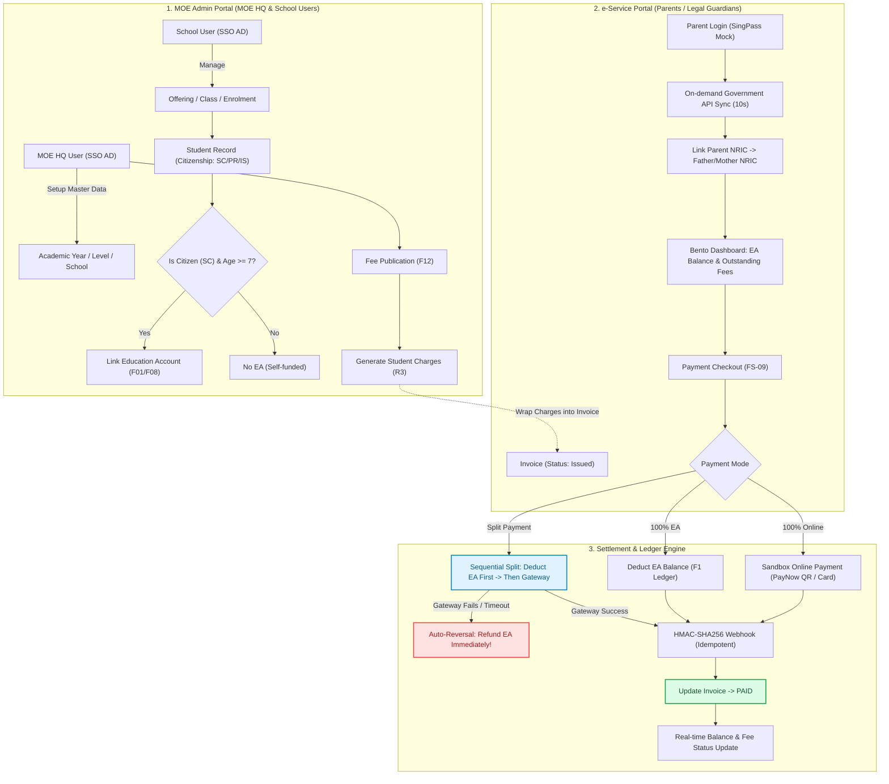

# MOE SINGAPORE: EDUCATION ACCOUNT, SCHOOL & FEE MANAGEMENT SYSTEM
## Agile Project Documentation, Modular Functional Specifications & Technical Audit

[](#)
[](#)
[](#)
[](#)

---

## 1. TỔNG QUAN HỆ THỐNG (EXECUTIVE OVERVIEW)

Dự án **Education Account & Fee Management System** do **Bộ Giáo dục Singapore (MOE HQ)** đầu tư xây dựng nhằm hiện đại hóa và tự động hóa toàn diện quy trình quản lý tài chính giáo dục, danh mục trường lớp học sinh, biểu phí tập trung và phân bổ trợ cấp tài chính xã hội.

Repository này được chuẩn hóa dưới định dạng **100% Markdown thuần túy (.md)**, cho phép toàn bộ đội ngũ kỹ sư, BA, QA và các bên liên quan có thể đọc trực tiếp trên GitHub, tìm kiếm toàn văn, kiểm tra `git diff` tức thì và quản lý phiên bản rõ ràng không phụ thuộc vào tệp nhị phân Microsoft Office.

### 🏛️ Hai phân hệ hợp nhất (Unified Dual-Portal Architecture):
1. **Admin Portal (MOE HQ & School Users):**
   - Xác thực người dùng qua **MOE Active Directory (AD) SSO** *(không lưu trữ mật khẩu trong hệ thống)*.
   - Quản lý vòng đời Tài khoản Giáo dục (Education Account - EA) của công dân Singapore từ 7 đến dưới 16 tuổi.
   - Nạp tiền (Top-Up) theo lô theo quy tắc hoặc đột xuất.
   - Quản trị danh mục trường học, cấp học/khối lớp, lớp học, hồ sơ học sinh và phân bổ lớp (Enrolment & Class Assignment).
   - Thiết lập biểu phí (Fee Types & Components), phát hành đợt thu học phí (Fee Publications) và sinh công nợ (Student Charges).
   - Xét duyệt trợ cấp tài chính toàn quốc (**MOEFAS**) và cấp trường (**SBFAS**) tích hợp mô hình **AI/ML phân loại mức độ rủi ro tài chính**.
   - Nhập đơn giấy ngoại tuyến (Hardcopy FAS) và quản lý hạn mức ngân sách giải ngân.
   - Giả lập góc nhìn người dùng (**View-As Simulation**) phục vụ hỗ trợ kỹ thuật.

2. **e-Service Portal (Parents & Legal Guardians):**
   - Xác thực định danh công dân bảo mật qua **SingPass**.
   - Tự động liên kết phụ huynh với học sinh qua dữ liệu quốc gia (On-demand API Sync).
   - Tra cứu thông tin tài khoản giáo dục, số dư EA khả dụng và lịch sử biến động số dư.
   - Tra cứu công nợ học phí và thực hiện thanh toán trực tuyến:
     - Thanh toán 100% bằng số dư EA.
     - Thanh toán 100% qua Cổng thanh toán trực tuyến (Sandbox Online Gateway: PayNow QR / Thẻ ngân hàng).
     - **Thanh toán chia đôi linh hoạt (Flexible Split Payment):** Kết hợp trích một phần số dư EA và trả phần còn lại qua cổng trực tuyến, tích hợp cơ chế **Tự động hoàn tiền (Auto-Reversal)** bảo vệ giao dịch.
   - Nộp đơn xin trợ cấp tài chính FAS theo đơn vị hộ gia đình (**Family Unit**) với sự hỗ trợ của **Trợ lý AI tự động điền form (AI Form Auto-Fill)**.

---

## 2. MA TRẬN 10 YÊU CẦU CỐT LÕI (CLIENT TENDER REQUIREMENTS)

| Req ID | Phân Hệ | Mô Tả Yêu Cầu Nghiệp Vụ (Client Tender Brief) | Tính Năng AI / ML Mở Rộng | Phân Bổ Sprint |
| :---: | :---: | :--- | :---: | :---: |
| **R1** | Admin Portal | Tài khoản giáo dục dành cho công dân Singapore (SC). Tự động kích hoạt khi trẻ đủ 7 tuổi, tự động tất toán đóng tài khoản khi đủ 16 tuổi và chuyển tiền về quỹ CPF. | — | **Sprint 1** |
| **R2** | Admin Portal | Chuyên viên MOE HQ nạp tiền (Top-Up) theo lô định kỳ hoặc đột xuất, lọc theo độ tuổi, số dư, tình trạng đi học, hoặc nạp riêng cho cá nhân. | — | **Sprint 2** |
| **R3** | Admin Portal | MOE HQ và Trường quản lý danh sách Trường, Khối/Lớp, Học sinh, Biểu phí và Cấu phần phí. Học sinh SC có thể dùng số dư EA để thanh toán học phí. | — | **Sprint 1** (Enrolment)<br>**Sprint 2** (Fees) |
| **R4** | Admin Portal | Xét duyệt Trợ cấp tài chính (FAS) đa tầng (MOEFAS toàn quốc & SBFAS cấp trường). Lấy dữ liệu thu nhập qua API chính phủ. Tự động giảm trừ vào học phí. | **AI/ML dự báo rủi ro tài chính** (Low / Medium / High Risk) & Gợi ý Assistance Tier | **Sprint 3** |
| **R5** | Admin Portal | Tiếp nhận và xử lý đơn xin trợ cấp FAS bản giấy do phụ huynh nộp trực tiếp tại trường học, quét file scan, tự động phát hiện trùng đơn online. | — | **Sprint 3** |
| **R6** | Admin Portal | MOE HQ thiết lập và theo dõi ngân sách MOEFAS toàn quốc. Trường học thiết lập và theo dõi ngân sách SBFAS nội bộ. Cảnh báo hạn mức. | — | **Sprint 3** |
| **R7** | Admin Portal | MOE HQ giả lập góc nhìn (View-As) của Cán bộ Trường hoặc Phụ huynh nhằm hỗ trợ giải đáp thắc mắc (chế độ Read-only an toàn). | — | **Post-MVP** |
| **R8** | e-Service Portal | Phụ huynh đăng nhập SingPass tra cứu số dư tài khoản EA của con em, lịch sử giao dịch và cập nhật thông tin liên lạc cá nhân (My Details). | **AI Chatbot** hỏi đáp chính sách và hỗ trợ người dùng động | **Sprint 1** |
| **R9** | e-Service Portal | Phụ huynh tra cứu công nợ học phí, chọn thanh toán qua EA hoặc qua cổng thanh toán trực tuyến (Sandbox Online Gateway). | — | **Sprint 1** |
| **R10** | e-Service Portal | Phụ huynh nộp đơn xin trợ cấp tài chính FAS chung cho toàn bộ con cái trong gia đình theo đơn vị Hộ gia đình (Family Unit). | **AI Auto-Fill** tự động trích xuất thông tin để điền đơn FAS | **Sprint 3** |

---

## 3. BẢN ĐỒ ĐẶC TẢ CHỨC NĂNG MODULE HÓA (FS-01 ĐẾN FS-10)

Toàn bộ đặc tả hệ thống đã được **module hóa hoàn toàn thành 10 tệp Markdown chuyên biệt** trong thư mục [`document/FS document/`](document/FS%20document/), giúp quản lý và cập nhật độc lập:

| Module ID | Req | Tên Phân Hệ & Hồ Sơ Đặc Tả | Tài Liệu Markdown (.md) | Phân Hệ (Portal) | Phân Bổ Sprint |
| :---: | :---: | :--- | :---: | :---: | :---: |
| **FS-01** | **R1** | **Education Account Lifecycle Management** | [FS-01.md](document/FS%20document/FS-01_Education_Account_Lifecycle.md) | Admin Portal | **Sprint 1** |
| **FS-02** | **R2** | **Education Account Top-Up Management** | [FS-02.md](document/FS%20document/FS-02_Education_Account_TopUp.md) | Admin Portal | **Sprint 2** |
| **FS-03** | **R3** | **School, Student & Fee Management** | [FS-03.md](document/FS%20document/FS-03_School_Student_Fee_Management.md) | Admin Portal | **Sprint 1 & 2** |
| **FS-04** | **R4** | **Financial Assistance Scheme (FAS) & AI Scoring** | [FS-04.md](document/FS%20document/FS-04_Financial_Assistance_Scheme_FAS.md) | Admin Portal | **Sprint 3** |
| **FS-05** | **R5** | **Hardcopy FAS Applications Processing (Offline)** | [FS-05.md](document/FS%20document/FS-05_Hardcopy_Applications_Offline.md) | Admin Portal | **Sprint 3** |
| **FS-06** | **R6** | **FAS Budget & Statistics Tracking** | [FS-06.md](document/FS%20document/FS-06_FAS_Budget_and_Statistics.md) | Admin Portal | **Sprint 3** |
| **FS-07** | **R7** | **User View Simulation / Impersonation** | [FS-07.md](document/FS%20document/FS-07_User_Simulation_ViewAs.md) | Admin Portal | **Post-MVP** |
| **FS-08** | **R8** | **Parent Portal (SingPass, Education Account, Profile)** | [FS-08.md](document/FS%20document/FS-08_Parent_Portal_SingPass_Profile.md) | e-Service Portal | **Sprint 1** |
| **FS-09** | **R9** | **Outstanding Fees and Payment Processing** | [FS-09.md](document/FS%20document/FS-09_Outstanding_Fees_and_Payment.md) | e-Service Portal | **Sprint 1** |
| **FS-10** | **R10** | **FAS Family Unit Application & AI Auto-Fill** | [FS-10.md](document/FS%20document/FS-10_FAS_Family_Application_Portal.md) | e-Service Portal | **Sprint 3** |

---

## 4. BỐN BÁO CÁO PHÂN TÍCH CHUYÊN SÂU (CORE ANALYTICAL DELIVERABLES)

Dự án cung cấp 4 báo cáo kỹ thuật toàn diện được xuất bản tự động phục vụ các bên liên quan:

```
document/
├── FSD_R3_GAP_AUDIT_REPORT.md            # Báo cáo Kiểm toán Khoảng cách FSD R3 vs Tender (21 Gaps, 16 CIRs)
├── REQUIREMENTS_AND_BACKLOG_SUMMARY.md   # Phân tích Backlog (14 User Stories, 28 PBIs, Questionnaire)
├── FS_SPECIFICATIONS_SUMMARY.md          # Phân tích Sâu Kiến trúc, FS-08, FS-09, Database Schemas & APIs
└── MEETINGS_AND_DECISIONS_SUMMARY.md     # Biên bản Cuộc họp, Decisions Log, CPF Transfer & Action Items
```

1. 🔍 **[Báo Cáo Kiểm Toán Khoảng Cách (FSD Gap Audit Report)](document/FSD_R3_GAP_AUDIT_REPORT.md)**:
   - Thực hiện theo tiêu chuẩn `combo-qa` (8 lăng kính B1–B8).
   - Phát hiện và phân loại **21 Gaps** (4 Blocker, 9 High, 7 Medium, 1 Low).
   - Đưa ra danh mục **16 Câu hỏi Làm rõ (CIR Items)** kèm các phương án lựa chọn và hệ quả cụ thể cho PO/Client.
2. 📋 **[Báo Cáo Phân Tích Yêu Cầu & Backlog (Requirements & Backlog)](document/REQUIREMENTS_AND_BACKLOG_SUMMARY.md)**:
   - Bóc tách 14 User Stories chuẩn Agile kèm tiêu chí BDD Gherkin (`Given - When - Then`).
   - Phân tích 28 Product Backlog Items và làm rõ **sự chuyển dịch Sprint (Sprint Shift)**: Kéo Cổng Phụ huynh (PB-06, 07, 08) và Thanh toán (PB-09, 10, 11) lên Sprint 1 kèm giải pháp Test Fixture.
   - Tổng hợp 12 Quyết định của Khách hàng (`CD-01` $\rightarrow$ `CD-12`) và 7 câu hỏi mở ưu tiên P1.
3. 🛠️ **[Báo Cáo Phân Tích Kỹ Thuật Chuyên Sâu (FS Deep-Dive)](document/FS_SPECIFICATIONS_SUMMARY.md)**:
   - Bóc tách toàn bộ kiến trúc giải pháp, máy trạng thái Invoice / Transaction, cơ chế Sequential Split Payment và Auto-Reversal.
   - Cung cấp toàn văn Data Schemas (`Parent_Profile`, `invoices`, `invoice_items`, `transactions`, `transaction_funding_sources`) và danh mục mã lỗi (`MSG-0801` $\rightarrow$ `MSG-0809`, `ERR-0901` $\rightarrow$ `ERR-0925`).
4. 📌 **[Báo Cáo Biên Bản Họp & Quyết Định (Meetings & Decisions Log)](document/MEETINGS_AND_DECISIONS_SUMMARY.md)**:
   - Lịch sử Kickoff Meeting (12/10), Sprint 1 Review (16/10) và Transcripts.
   - Các quyết định quan trọng: Bắt buộc SSO qua MOE Active Directory (loại bỏ lưu password), kết chuyển số dư EA sang quỹ hưu trí CPF khi tròn 16 tuổi, đổi nhãn `student_category` thành `citizenship`.

---

## 5. SƠ ĐỒ KIẾN TRÚC LUỒNG DỮ LIỆU & THANH TOÁN (ARCHITECTURE DIAGRAM)



---

## 6. CẤU TRÚC THƯ MỤC REPOSITORY (100% MARKDOWN)

```
.
├── README.md                                       # Báo cáo tổng quan dự án (File này)
├── .gitignore                                      # Bộ lọc tệp tin hệ thống và tệp nhị phân Office
└── document/                                       # Toàn bộ tài liệu dự án định dạng Markdown
    ├── README.md                                   # Bảng chỉ mục tài liệu dự án
    ├── FSD_R3_GAP_AUDIT_REPORT.md                  # Báo cáo kiểm toán khoảng cách đặc tả R3
    ├── REQUIREMENTS_AND_BACKLOG_SUMMARY.md         # Báo cáo phân tích Backlog & Questionnaire
    ├── FS_SPECIFICATIONS_SUMMARY.md                # Báo cáo phân tích kỹ thuật chuyên sâu FS-08 & FS-09
    ├── MEETINGS_AND_DECISIONS_SUMMARY.md           # Báo cáo biên bản họp & Decisions Log
    ├── First_meeting_questions.md                  # Bộ câu hỏi sơ khởi phiên làm việc đầu tiên
    ├── Noi_dung_Overview_Sprint_1.md               # Kế hoạch thực hiện Sprint 1
    ├── Documentation/                              # Biên bản họp, Transcript, Glossary & Q&A
    │   ├── Agile_Glossary.md
    │   ├── Kickoff_Transcript_refined.md
    │   ├── MoM_Kickoff_meeting_12_10.md
    │   ├── MoM_Sprint_1_16_10.md
    │   └── Sprint_1_Review_Transcript.md
    ├── FS document/                                # Toàn bộ 10 hồ sơ đặc tả chức năng Module hóa
    │   ├── FS-01_Education_Account_Lifecycle.md
    │   ├── FS-02_Education_Account_TopUp.md
    │   ├── FS-03_School_Student_Fee_Management.md
    │   ├── FS-04_Financial_Assistance_Scheme_FAS.md
    │   ├── FS-05_Hardcopy_Applications_Offline.md
    │   ├── FS-06_FAS_Budget_and_Statistics.md
    │   ├── FS-07_User_Simulation_ViewAs.md
    │   ├── FS-08_Parent_Portal_SingPass_Profile.md
    │   ├── FS-09_Outstanding_Fees_and_Payment.md
    │   └── FS-10_FAS_Family_Application_Portal.md
    └── Requirement analysis/                       # Tài liệu phân tích yêu cầu & kiến trúc giải pháp
        ├── High-level_Solution.md
        ├── Function_Requirements.md
        └── Functional_Requirement_3.md
```

---

## 7. QUY TRÌNH PHỐI HỢP & BẢO TRÌ (CONTRIBUTION GUIDELINES)

1. **Chuẩn hóa Markdown:** Mọi tài liệu kỹ thuật, đặc tả chức năng và biên bản họp đều được duy trì dưới định dạng Markdown để phục vụ tra cứu nhanh và theo dõi `git diff`.
2. **Cập nhật phân tán theo Module:** Khi có cập nhật bất kỳ tính năng nào từ R1 đến R10, chỉnh sửa trực tiếp vào tệp `document/FS document/FS-XX_<Name>.md` tương ứng.
3. **Theo dõi User Stories & AC:** Mọi thay đổi về điều kiện biên cần đối chiếu lại với Acceptance Criteria tại [`document/REQUIREMENTS_AND_BACKLOG_SUMMARY.md`](document/REQUIREMENTS_AND_BACKLOG_SUMMARY.md) và các quyết định khách hàng tại [`document/MEETINGS_AND_DECISIONS_SUMMARY.md`](document/MEETINGS_AND_DECISIONS_SUMMARY.md).
4. **Tuân thủ chuẩn bảo mật:** Bảo đảm tuân thủ nguyên tắc không lưu trữ mật khẩu nội bộ (SSO qua Active Directory) và bảo vệ dữ liệu công dân (SingPass, On-demand sync timeout 10s).
