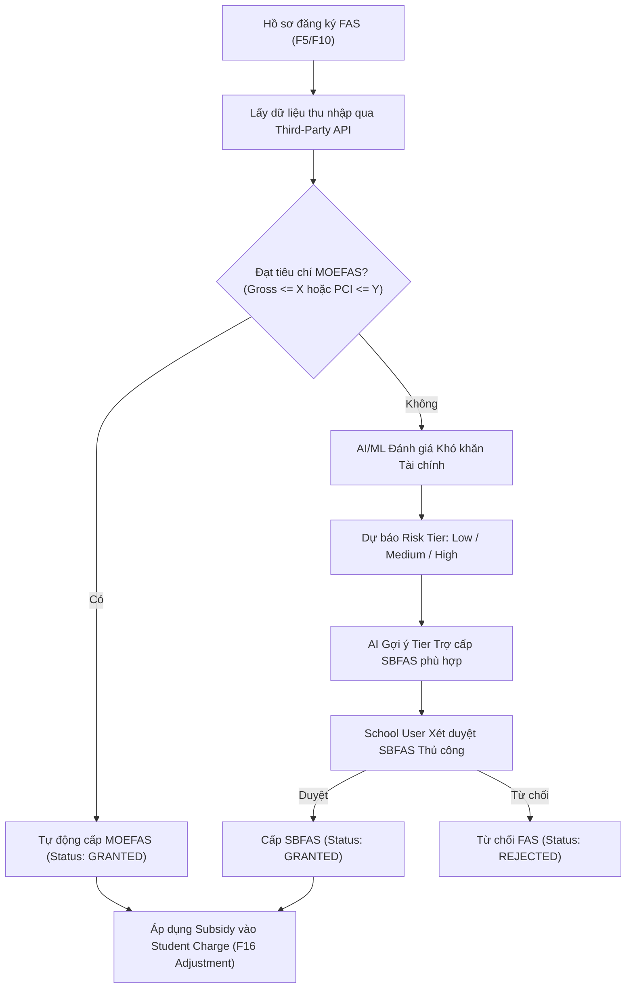

# FS-04: Financial Assistance Scheme - FAS & AI Scoring (Requirement 4)

> **Phân hệ**: Admin Portal (MOE HQ & School Users)  
> **Requirement**: R4 – Financial Assistance Scheme (FAS)  
> **Product Backlog**: PB-17, PB-19, PB-25 (Sprint 3) | **User Story**: US-05, US-AI1  
> **Trạng thái**: Specification Ready  

---

## 1. TỔNG QUAN (OVERVIEW)
Phân hệ Trợ cấp Tài chính (FAS) cho phép quản lý, cấu hình và xét duyệt các gói hỗ trợ tài chính cho học sinh có hoàn cảnh khó khăn. Hệ thống kết hợp **Luật thẩm định tự động (Rule-based Auto-Grant)** cho gói toàn quốc (MOEFAS) và **Trí tuệ nhân tạo (AI/ML)** để phân loại mức độ rủi ro tài chính, đề xuất mức hỗ trợ cho gói cấp trường (SBFAS).

### 1.1. Các chương trình hỗ trợ
1. **MOEFAS (Nationwide Scheme):** Gói hỗ trợ chuẩn cấp quốc gia của Bộ Giáo dục. Tự động cấp nếu học sinh đáp ứng tiêu chí định sẵn.
2. **SBFAS (School-based FAS):** Gói hỗ trợ do từng trường quản lý. Áp dụng cho các học sinh không đủ điều kiện MOEFAS nhưng vẫn gặp khó khăn thực tế.

---

## 2. QUY TRÌNH THẨM ĐỊNH & XÉT DUYỆT (ASSESSMENT PROCESS)

### 2.1. Tiêu chí xét tuyển (Eligibility Criteria)
- **Quốc tịch (Nationality):** Công dân Singapore (SC).
- **Thu nhập tổng hộ gia đình (Gross Household Income - GHI):** Ví dụ GHI <= 3,000 SGD/tháng.
- **Thu nhập bình quân đầu người (Per Capita Income - PCI):** Ví dụ PCI <= 750 SGD/tháng.
- **Dữ liệu thu nhập:** Thu thập tự động qua API kết nối các cơ quan chính phủ (GovTech / IRAS API) khi nộp đơn.

### 2.2. Tính năng Trí tuệ Nhân tạo (AI Features)
- **ML Financial Difficulty Prediction (US-AI1):** Phân loại gia đình thành 3 mức độ khó khăn:
  - `Low Risk`: Có khả năng tự chi trả phần phí còn lại.
  - `Medium Risk`: Có nguy cơ trễ hạn hoặc gặp khó khăn thanh toán.
  - `High Risk`: Nguy cơ cao không thể thanh toán nếu không có trợ cấp bổ sung.
- **AI Tier Recommendation:** Đề xuất tỷ lệ miễn giảm cụ thể (ví dụ: Miễn 100% học phí + 50% phụ phí ngoại khóa) cho Cán bộ trường tham khảo.

### 2.3. Áp dụng kết quả vào Học phí (Subsidy Application)
- Kết quả trợ cấp sau khi được duyệt sẽ tự động kích hoạt tạo **Student Charge Adjustment (F16)** trong R3 / FS-09:
  - Giảm trừ trực tiếp số tiền phải đóng của từng cấu phần phí (Fee Component) được trợ cấp.
  - Số tiền gốc không bị sửa đè; ghi nhận rõ mã điều chỉnh `FAS_SUBSIDY_MOE` hoặc `FAS_SUBSIDY_SB`.

---

## 3. RÀNG BUỘC NGHIỆP VỤ (BUSINESS RULES)
- **BR-R4-01 (Auto-Grant MOEFAS):** Nếu hồ sơ thỏa mãn GHI hoặc PCI của MOEFAS, hệ thống tự động duyệt, không cần can thiệp thủ công.
- **BR-R4-02 (School Discretion on SBFAS):** Cán bộ trường có toàn quyền phê duyệt hoặc từ chối SBFAS dựa trên ngân sách trường và gợi ý của AI.
- **BR-R4-03 (Audit Integrity):** Lưu trữ toàn bộ lịch sử điểm số AI, người duyệt, ngày duyệt và giá trị subsidy áp dụng.
